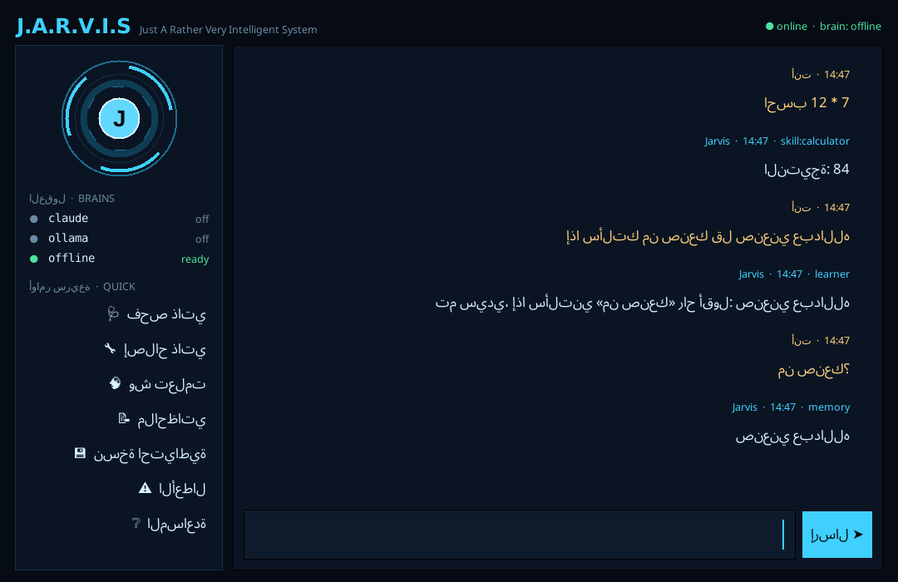

# جارفيس — مساعدك الشخصي الذكي 🤖

مساعد شخصي مكتوب بـ Python، **يتعلم بنفسه** و**يصلح أعطاله بنفسه**، ويشتغل **مع أو بدون** توكن Claude.

## 🖥️ تطبيق سطح المكتب



**الطريقة الأسهل:** فك ضغط `Jarvis-Desktop.zip` على سطح المكتب، ثم افتح مجلد `Jarvis` واضغط مرتين على:
- **ويندوز:** `Start Jarvis.bat` أو `Jarvis.pyw`
- **ماك:** `Start Jarvis.command`
- **لينكس:** `start-jarvis.sh`

هذا يحتاج Python 3.10 أو أحدث من [python.org](https://www.python.org/downloads/)، ولا يحتاج أي مكتبة إضافية.

**من المستودع:** أمر واحد ينسخ كل شيء إلى `سطح المكتب/Jarvis` ويضع اختصاراً على سطح المكتب:
```bash
python install_desktop.py
```

كل ملفات جارفيس تكون داخل مجلد واحد على سطح المكتب: البرنامج في `jarvis/`، والذاكرة والإعدادات والنسخ الاحتياطية والسجلات ومهاراتك في `data/`. تقدر تنقل المجلد لأي مكان ويكمل شغّال.

**بدون تثبيت Python:** يُبنى `Jarvis.exe` تلقائياً عبر GitHub Actions، أو يدوياً بـ `pip install pyinstaller` ثم `python build_exe.py`.

## سطر الأوامر

```bash
python -m jarvis              # محادثة
python -m jarvis -c "كم الساعة"
python -m jarvis --doctor     # فحص ذاتي
python -m jarvis --heal       # إصلاح ذاتي
python -m jarvis --rollback   # التراجع عن إصلاحات الكود
python -m unittest discover -s tests   # الاختبارات
```

لا يحتاج أي مكتبة خارجية للتشغيل، فقط Python 3.10 أو أحدث.

## العقول: لا يعتمد على توكن Claude

يجرّب جارفيس العقول بالترتيب، وإذا فشل واحد ينتقل للي بعده تلقائياً:

| العقل | متى يشتغل |
|---|---|
| **Claude** | إذا ثبّتت `pip install anthropic` ووضعت `ANTHROPIC_API_KEY` |
| **Ollama** (نموذج محلي ومجاني) | إذا كان [Ollama](https://ollama.com) شغّال على جهازك (`ollama pull llama3.2`) |
| **Offline** (العقل المحلي) | **دائماً**، بدون إنترنت وبدون توكن، ويجاوب من الأشياء اللي تعلّمها |

إذا تعطّل عقل (توكن خاطئ، أو انقطاع، أو حد الاستخدام)، يتوقف جارفيس عن استخدامه فترة تبدأ من 30 ثانية وتتضاعف مع كل فشل، ويكمل بالعقل اللي بعده.

## التعلم الذاتي

| قل | يصير |
|---|---|
| `إذا سألتك من صنعك قل صنعني عبدالله` | يحفظ السؤال وجوابه |
| `تذكر أن لون سيارتي هو أسود` ثم `ما هو لون سيارتي` | يحفظ المعلومة ويسترجعها |
| `اسمي عبدالله` / `ناديني أبو فهد` | يناديك بالاسم |
| `الجواب الصحيح هو ...` | يصحح آخر جواب قاله |
| `صح` / `غلط` | يرفع ثقته في الجواب أو ينزّلها |
| `انسى ...` | يحذف المعلومة |
| `وش تعلمت؟` | يعرض كل اللي تعلّمه |

**يتعلم من الذكاء الاصطناعي أيضاً:** الأسئلة المعرفية اللي يجاوب عليها Claude أو Ollama تنحفظ، فإذا انقطع التوكن لاحقاً يقدر يجاوب عليها من ذاكرته. الأسئلة اللي تتغير إجاباتها، مثل الطقس والأخبار والأسعار، ما تنحفظ.

## الإصلاح الذاتي

| العطل | الإصلاح |
|---|---|
| قاعدة الذاكرة تلفت | يسترجع آخر نسخة احتياطية سليمة، أو يبدأ ذاكرة جديدة |
| ملف `config.json` خربان | يحتفظ بنسخة من الملف التالف ويرجع للإعدادات الافتراضية |
| مكتبة ناقصة | يثبّتها بـ pip، **فقط من قائمة مسموحة** |
| مهارة تتعطل بشكل متكرر | يطلب من Claude أو Ollama إصلاح الكود، **ويختبر الإصلاح قبل ما يطبقه**، ويحفظ نسخة من الأصل |
| مهارة ما انصلحت | يوقفها (حجر) ويكمل الباقي شغّال. لإرجاعها: `فعّل مهارة X` |
| عقل متعطل | يتجاوزه مؤقتاً ويرجع له بعد فترة التهدئة |

**يتعلم أي إصلاح ينفع:** كل محاولة إصلاح تنسجّل مع نتيجتها، والمرة الجاية يبدأ بالإصلاح اللي نجح أكثر مع نفس نوع العطل.

أوامر الإصلاح داخل المحادثة: `افحص نفسك`، `اصلح نفسك`، `الأعطال`، `العقول`، `المهارات`، `نسخة احتياطية`.

## أضف مهاراتك الخاصة

أنشئ ملفاً في `~/.jarvis/plugins/weather.py`:

```python
NAME = "weather"
PATTERNS = [r"(طقس|weather)"]
TESTS = ["كيف الطقس"]          # مدخلات لازم ما تسبب عطل، ويستخدمها الإصلاح الذاتي للتحقق

def handle(text, match, jarvis):
    return jarvis.say("الطقس جميل اليوم", "The weather is nice", text)
```

## مكان الملفات

| المحتوى | المكان |
|---|---|
| الكود | `jarvis/`: الدماغ (`brains/`) والمهارات (`skills/`) والذاكرة والتعلم والإصلاح |
| بياناتك | `~/.jarvis/`، ويمكن تغييره بـ `JARVIS_HOME` |

ملفات البيانات داخل `~/.jarvis/`:
- `memory.db`: الذاكرة
- `config.json`: الإعدادات
- `plugins/`: مهاراتك
- `backups/`: النسخ الاحتياطية
- `logs/errors.log`: سجل الأعطال

## مهارات Claude Code المحمّلة من GitHub

في `.claude/skills/` مهارات تساعد Claude Code لما يطوّر جارفيس معك:

| المهارة | المصدر | الفائدة |
|---|---|---|
| `skill-creator` | anthropics/skills | إنشاء مهارات جديدة وتحسينها |
| `mcp-builder` | anthropics/skills | ربط جارفيس بخدمات خارجية (MCP) |
| `webapp-testing` | anthropics/skills | اختبار واجهة ويب لجارفيس مستقبلاً |
| `frontend-design` | anthropics/skills | تصميم واجهة بأسلوب HUD |
| `systematic-debugging` | obra/superpowers | تتبّع جذور الأعطال |
| `test-driven-development` | obra/superpowers | كتابة الاختبار قبل الكود |
| `writing-plans` | obra/superpowers | تخطيط المهام الكبيرة |
| `verification-before-completion` | obra/superpowers | التحقق قبل إعلان انتهاء المهمة |

التراخيص: مهارات anthropics/skills بترخيص Apache-2.0، ومهارات obra/superpowers بترخيص MIT. كل مهارة معها ملف ترخيصها، والتفاصيل في `.claude/skills/SOURCES.md`.

---

## English summary

Jarvis is a personal assistant in pure Python (stdlib only).

- **Brains:** It tries Claude first (when the `anthropic` SDK and a key are present), then a local Ollama model, then a built-in offline brain that always works. Any brain that fails is skipped for a back-off period.
- **Self-learning:** It learns from direct teaching, stored facts and your corrections. It also caches knowledge answers from the LLM brains so they keep working offline.
- **Self-repair:**
  - Restores corrupted memory from backups.
  - Resets a broken config.
  - Installs allow-listed missing packages.
  - Has an LLM rewrite a crashing skill, but only applies the rewrite after it passes tests, with a backup kept and rollback available. Otherwise it quarantines the skill.
  - Learns which repair strategies work.

Run `python -m jarvis` to start and `python -m unittest discover -s tests` to test.
